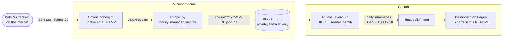

<div align="center">

# Azure Honeypot

**An SSH & Telnet honeypot on Microsoft Azure that records real attacks, maps them to MITRE ATT&CK<br>and publishes them as a live dashboard. Fully automated, with no secrets stored anywhere.**

[](https://github.com/ondrej-cloud/azure-honeypot/actions/workflows/pipeline.yml)
[](https://github.com/ondrej-cloud/azure-honeypot/actions/workflows/ci.yml)
[](LICENSE)

### [Open the live dashboard →](https://ondrej-cloud.github.io/azure-honeypot/)

</div>

## Live numbers

Refreshed automatically every 6 hours by GitHub Actions.

<!-- STATS:START -->
_No data yet: the sensor is warming up. This section refreshes automatically every 6 hours once attacks start arriving._
<!-- STATS:END -->

## How it works



1. **Sensor.** [Cowrie](https://github.com/cowrie/cowrie) listens on ports 22 and 23 and pretends to be a Linux
   server. It logs every login attempt, accepts some of them, and gives the attacker a fully emulated shell that
   records each command and downloaded file. The real `sshd` moves to port 22222, reachable only from my IP.
2. **Shipping.** Every hour a small stdlib-only Python script uploads that day's log to a private Blob container.
   It authenticates with the VM's managed identity through the Instance Metadata Service, so the VM holds no key.
3. **Analysis.** Every 6 hours a GitHub Actions workflow logs in to Azure through OIDC federation, downloads only
   new or changed blobs and condenses each day into a small summary in [`data/daily/`](data/daily). IPs are
   enriched with country and ASN from the public-domain [iptoasn.com](https://iptoasn.com) dataset, and
   commands are mapped to [MITRE ATT&CK](https://attack.mitre.org) techniques
   ([`pipeline/attack.py`](pipeline/attack.py)).
4. **Publishing.** The same workflow rebuilds [`stats.json`](docs/data/stats.json), the SVG charts and the numbers
   above, commits them, and deploys the [D3 dashboard](docs) to GitHub Pages.

## Security design

A honeypot invites attackers in on purpose, so the design assumes the emulator itself could be broken.

| Risk | Mitigation |
|---|---|
| Attacker escapes Cowrie's emulated shell | Container runs as non-root on a distroless image with a read-only root filesystem, all Linux capabilities dropped, `no-new-privileges`, and memory and PID limits |
| Honeypot abused as a proxy or spam relay | SSH port forwarding disabled (verified: `direct-tcpip` channels are refused), outbound SMTP dropped by the host firewall, and Azure blocks port 25 too |
| SSRF to the Azure metadata service to steal the VM's token | Cowrie's fake `wget`/`curl` fetch real URLs, so an `iptables` `DOCKER-USER` chain drops container traffic to IMDS (169.254.169.254) and WireServer (except DNS) |
| Brute force against the real admin SSH | Moved to port 22222, key-only, no root login, and the NSG only admits the operator's IP |
| Leaked credentials | There are none to leak: the VM writes with its managed identity, GitHub reads through OIDC federation, and the storage account has shared keys and SAS tokens **disabled** |
| Log tampering after a host compromise | The VM's role is scoped to a single container, and blob soft delete keeps overwritten logs for 7 days |
| XSS or Markdown injection through attacker-chosen passwords and commands | The dashboard writes attacker text only through `textContent`, under a strict CSP with Subresource Integrity on CDN scripts. README and SVG output is escaped, and tests feed it hostile input |
| Clicking live malware links | URLs are defanged (`hxxp://203.0.113[.]5/x.sh`), hashes link to VirusTotal, and samples never leave the VM |

## What gets published

Raw logs stay private in Azure Storage. The repository only receives per-day aggregates: per-IP counters,
top usernames, passwords and commands, client banners, technique counts and download hashes. Source IPs are
published because they are the attack sources, the same data shared on AbuseIPDB and blocklists. Most of them are
compromised machines or rented servers, so the dashboard links to a reputation lookup and asks visitors to
report abuse, not retaliate.

## Deploy your own

**You need:** an Azure subscription ([Azure for Students](https://azure.microsoft.com/free/students) works and
needs no credit card), the [Azure CLI](https://learn.microsoft.com/cli/azure/install-azure-cli), the
[GitHub CLI](https://cli.github.com) and an SSH key (`ssh-keygen -t ed25519`).

```bash
gh repo fork ondrej-cloud/azure-honeypot --clone && cd azure-honeypot
az login
make deploy                      # or: LOCATION=swedencentral make deploy
```

`make deploy` checks that the VM size is available in your region, deploys [`infra/main.bicep`](infra/main.bicep),
and sets the three non-secret repository variables the workflow needs (`AZURE_CLIENT_ID`, `AZURE_TENANT_ID`,
`STORAGE_ACCOUNT`). Azure requires multi-factor authentication for creating resources, so if it stops with
`AADSTS50079`, set up a method at [aka.ms/mfasetup](https://aka.ms/mfasetup) and run the `az login` command it
prints. Then:

1. In GitHub, go to **Settings → Pages** and set the source to **GitHub Actions**.
2. Under **Actions → Update stats & deploy dashboard**, click **Run workflow**.

First boot takes about 5 minutes. Bots usually find the new IP within the hour.

**What it costs** (approximate; check the [pricing calculator](https://azure.microsoft.com/pricing/calculator/)):

| Resource | Monthly |
|---|---|
| VM Standard_B1s, Linux | free tier (750 h/month for 12 months) |
| 64 GB Premium SSD (P6) | free tier (12 months) |
| Static public IPv4 | ≈ $3.65 |
| Blob storage and transactions | < $0.10 |
| **Total** | **≈ $4**, about two years of the $100 student credit |

## Operating it

```bash
make ssh             # shell on the VM (real sshd on port 22222)
make logs            # watch attacks arrive live
make allow-ip        # your home IP changed? re-open the admin port to it
make update-sensor   # push changes in sensor/ (cloud-init only runs at first boot)
make destroy         # delete every Azure resource
```

Expect Microsoft Defender for Cloud to flag brute-force attempts against the VM. That's the point.

## Local development

```bash
make test            # unit tests (Python 3.9+, no dependencies)
make demo            # synthetic attacks -> docs/data/stats.demo.json
make serve           # http://localhost:8000/?demo
```

The pipeline is plain standard-library Python. [`tests/fixtures/cowrie-3.1.json`](tests/fixtures/cowrie-3.1.json)
was recorded from a real Cowrie 3.1 container under simulated attack, including an XSS payload.

```text
infra/       Bicep template and cloud-init: VM, network, storage, identities, RBAC
sensor/      docker-compose.yml for Cowrie and the hourly log shipper
pipeline/    fetch -> daily summaries -> stats.json, README charts, ATT&CK mapping
docs/        the dashboard (GitHub Pages): HTML, CSS, D3, generated data and charts
data/daily/  one committed summary per day
scripts/     deploy, admin-IP and sensor update helpers
tests/       unit tests and the recorded Cowrie fixture
```

## Ideas for later

- Report the noisiest IPs to AbuseIPDB automatically
- Add an HTTP honeypot and sensors in more regions to compare who scans where
- Ship the same events to Microsoft Sentinel and write KQL detections against them
- Triage captured samples with YARA rules

## Credits

[Cowrie](https://github.com/cowrie/cowrie) (BSD), IP-to-ASN data by [iptoasn.com](https://iptoasn.com) (PDDL),
[world-atlas](https://github.com/topojson/world-atlas) / Natural Earth map data, country codes from
[lukes/ISO-3166-Countries-with-Regional-Codes](https://github.com/lukes/ISO-3166-Countries-with-Regional-Codes),
and [D3](https://d3js.org). MITRE ATT&CK® is a registered trademark of The MITRE Corporation.
