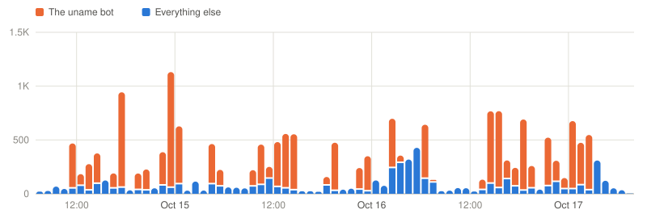
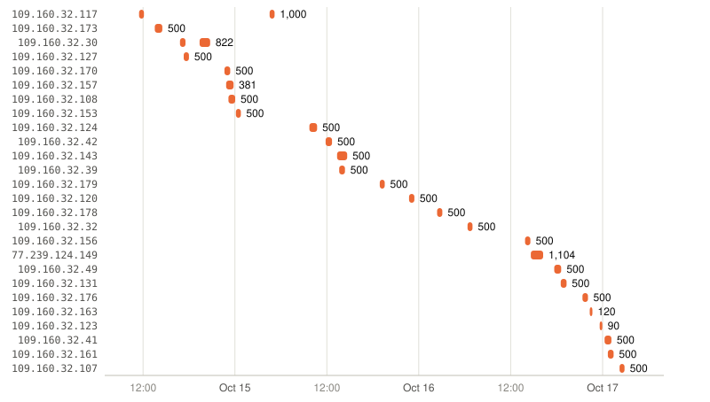

# One bot, 71% of the traffic

**What the "Romanian" spike on my honeypot dashboard actually was.** First 72 hours of the sensor,
14–17 October 2026.

Three days after the honeypot went live, the dashboard said Romania had sent 13,500 of its first 18,800
connections. That sounded like a story about a country. It turned out to be one piece of software
running from 26 rented IP addresses, working through a shared password list in shifts of exactly 500.

> **TL;DR**
> - **13,517 of 18,986 sessions (71%)** came from one bot. It logged in, ran `uname -s -v -n -r -m`
>   and left, all in under a second.
> - **26 IP addresses took turns.** 23 of their 28 shifts were exactly 500 logins long, and in 118 of
>   139 ten-minute windows only one address was working.
> - **No password was tried twice by two different addresses.** 13,195 distinct username/password
>   pairs were split between the IPs, like a job queue.
> - **"Romania" is just where the route is registered.** The address blocks belong to a US-labelled
>   and a French-labelled network, and are announced by a Romanian autonomous system that only
>   started announcing one of them three weeks earlier.

[Open this campaign on the live dashboard](https://ondrej-cloud.github.io/azure-honeypot/#all&campaign=c-55521c2b)
· [watch one of its sessions](https://ondrej-cloud.github.io/azure-honeypot/#all&replay=7ab552f01de999cb)

## One fingerprint, thousands of sessions

Every one of these sessions looks the same:

| | |
|---|---|
| SSH client banner | `SSH-2.0-Go` (Go's `x/crypto/ssh` library) |
| HASSH | `0a07365cc01fa9fc82608ba4019af499` |
| Logins per session | 1 |
| Commands per session | 1: `uname -s -v -n -r -m` |
| Session length | median 0.84 s |
| Downloads or persistence | none |

The dashboard's campaign grouping caught this on its own: it clusters sessions by the commands they run,
and this cluster has a single command and 13,517 members.

HASSH alone would not have been enough. It fingerprints the client *library*, and two unrelated IPs
that ran different commands shared it during the same three days. The combination of client, command and
behaviour is what makes this one actor.

## 26 IPs, taking turns



The bot is the orange bars on top of the blue ones. Without it the sensor sees a median of about 50
connections an hour (most hours between 25 and 135); with it, single hours reach 1,100. The bursts are not random. Each one is an
IP address working through a shift:



- **Shifts of 500.** 23 of the 28 shifts were exactly 500 logins. The median shift took 43 minutes
  (38–79), about one login every 5.2 seconds.
- **One at a time.** In 118 of the 139 ten-minute windows where the bot was active, a single IP was
  working. There were never more than three at once.
- **Retries.** `109.160.32.30` finished its 500, and two hours later started on the same 500 pairs
  again, stopping after 322: the same work unit handed out twice.
- **Two networks.** 25 of the addresses sit in `109.160.32.0/24`, one in `77.239.124.0/24`.

This looks like a central coordinator handing out work units of 500 credentials to whichever worker is
free, rather than 26 independent infected machines.

## A password list, split, not repeated

Across all shifts the bot tried 13,195 distinct username/password pairs (2,508 usernames, 1,348
passwords). **Not a single pair was tried by two different IPs.** The only repeats are the retried job
above.

The list is broad rather than deep. `root` is the most common username, but only 399 times. The rest is
a long tail of service and default accounts such as `ubuntu`, `admin`, `deploy`, `ftpuser` and `kafka`,
paired with weak passwords like `123456`, `1234` and `qwer1234`. It reads like a merged combo list
from earlier leaks rather than a dictionary attack against one account.

### Why it looks so large here

Cowrie accepts almost any password on purpose, so the bot "succeeded" 13,517 times. On a real server
nearly all of these logins would fail and the bot would move on. It is cheap for the bot either way: one
connection every five seconds per address doesn't stand out on a big network.

## What it wanted

`uname -s -v -n -r -m` prints the kernel name, version, hostname, release and CPU architecture
([T1082 System Information Discovery](https://attack.mitre.org/techniques/T1082/)). The bot never did
anything with the answer: no download, no SSH key, no second command, and nobody came back to use the
logins it collected within the window.

That fits a **credential checker**: build a list of logins that work, tagged with what kind of machine
each one opens, and hand it to a second stage or sell it as access. I can't see a second stage from a
single sensor. Of the 13,195 pairs, 124 were also tried by other sources in the same period, but those
are the generic defaults everyone tries (`admin`/`admin`, `root`/`admin`, `support`/`support`), not a
sign that anyone came back with the bot's findings.

## Why the map says Romania

The dashboard places an IP in the country of the network that announces its route, using
[iptoasn.com](https://iptoasn.com). The RIPE database tells a more layered story (looked up on
17 October 2026):

| | `109.160.32.0/24` | `77.239.124.0/24` |
|---|---|---|
| Registered as | `GBTCloud`, country US | `RocketCloud`, country FR, organisation in GB |
| Block record created | 2020 | July 2026 |
| Route objects | AS197170 (TechTies Inc., Seychelles) from 1 Sep 2026, then AS198364 from 25 Sep 2026 | announced by AS198364 |

AS198364 belongs to a Romanian company in Timișoara; the autonomous system was registered in 2026.
Small networks announcing address space that is registered to someone else, and moving between
providers, is normal in the IP leasing market and common among low-cost hosting. It says nothing
about who operates the bot or whether the network operator knows. It does mean the country on the map
describes a routing arrangement, not the attacker.

## What I take from it

- **Country blocking would have hit nothing.** The same /24 was "Seychelles" three weeks earlier and
  could be somewhere else next month.
- **Per-IP rate limits only shorten shifts.** fail2ban would stop each address after a few failures,
  but the coordinator would hand the next 500 pairs to another address.
- **Key-only SSH makes the whole list worthless.** Every one of the 13,195 pairs relies on password
  authentication being enabled. My real admin SSH, on a separate port, accepts keys only.
- **Top-N views mislead.** One noisy client set the "top country", the "top command" and most of the
  ATT&CK counts. Counting distinct IPs and campaigns alongside raw sessions keeps that visible.

## Indicators

| Type | Value |
|---|---|
| Networks | `109.160.32.0/24`, `77.239.124.149` |
| Client banner | `SSH-2.0-Go` |
| HASSH | `0a07365cc01fa9fc82608ba4019af499` (shared with other Go tools) |
| Command | `uname -s -v -n -r -m` |
| Behaviour | 1 login and 1 command per connection, about one connection every 5 s per IP, 500 per IP |

## Method and limits

- **Data:** the raw Cowrie JSON logs from 2026-10-14 07:46 to 2026-10-17 07:06 UTC, one sensor
  (Azure, Denmark East), SSH on port 22 and Telnet on port 23. My own admin IPs are removed first.
- **Bot sessions:** client `SSH-2.0-Go` and exactly one command, `uname -s -v -n -r -m`. A *shift* is a
  run of connections from one IP with no pause longer than 30 minutes.
- **Reproduce:** [`analyze.py`](analyze.py) recomputes every number here and redraws both charts:

  ```sh
  IGNORE_IPS="$(cat .admin-ips)" python3 writeups/2026-10-one-bot/analyze.py cowrie/2026-10-1[4-7].json.gz
  ```

- **Limits:** one sensor and three days is a small sample. A honeypot that accepts every password
  inflates "successful" logins. And geolocation by announcing network is a statement about routing,
  not about where a machine or a person is.
